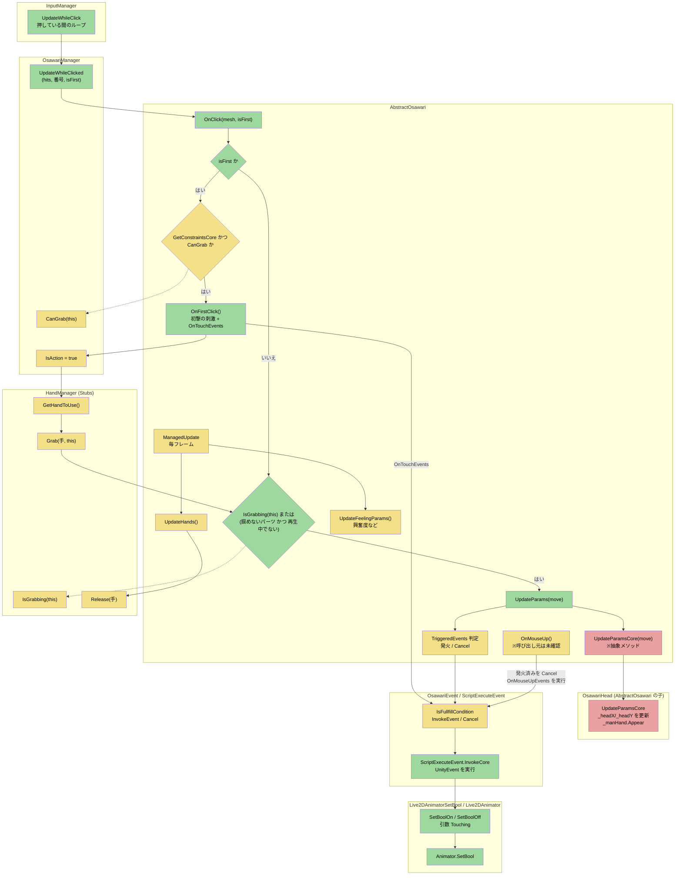

# 掴み処理の流れ(通常版)

箱は「クラス単位」でまとめています。枠のタイトルがクラス名です。

## 色の意味

- 緑: ログやスタックトレースで、実際に通ったことを確認できた箇所
- 黄: コードは読んだが、動作は確認できていない箇所(呼び出しの形からの推測を含む)
- 赤: 今回の次の確認対象(首のパラメータが実際に動くか)

## クラスごとの役割

| クラス | この流れでの役割 | 確認状況 |
| --- | --- | --- |
| InputManager | マウスの押下を検知し、押している間ループを回す | ログで確認済み |
| OsawariManager | 掴めるかの判定(`CanGrab`)と、押している間の窓口 | `UpdateWhileClicked` はログ確認済み。`CanGrab` の中身は未読 |
| AbstractOsawari | 掴み、動かす、離す、の中心 | コードを読んだ |
| OsawariHead | 首のパラメータを実際に動かす | 未読(最初の資料で一部のみ) |
| HandManager | 今どのパーツを掴んでいるかの状態管理 | 現在のスタブの中身は未確認 |
| OsawariEvent / ScriptExecuteEvent | 条件判定とイベント発火 | `InvokeCore` まではログ確認済み |
| Live2DAnimatorSetBool / Live2DAnimator | `Touching` を Animator に渡す | ログ確認済み |

## 未確認のまま残っていること

- `OnMouseUp` を誰が呼んでいるか(`OsawariManager` の可能性が高いが未確認)
- `Grab` の直後に `CanGrab` が false になる理由
- `UpdateParamsCore` が実際にパラメータを動かすか(`move` が 0 のままだった)